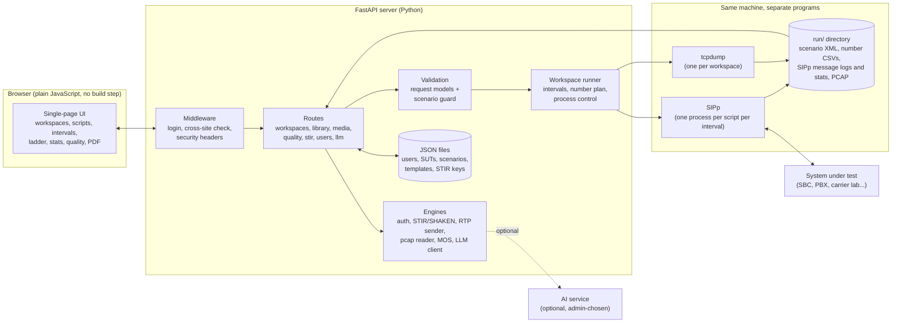
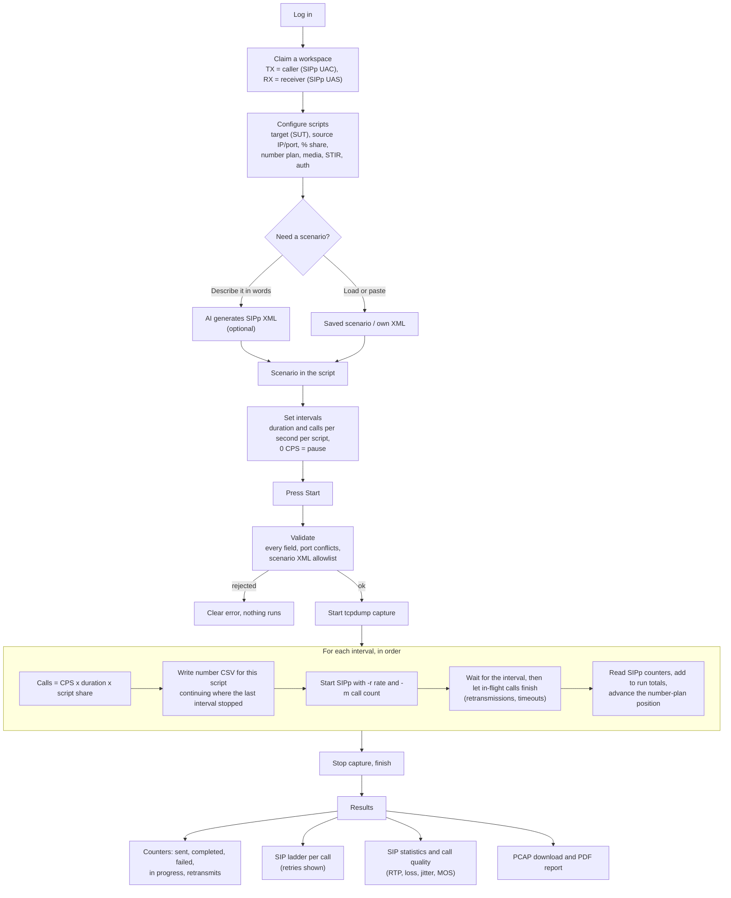
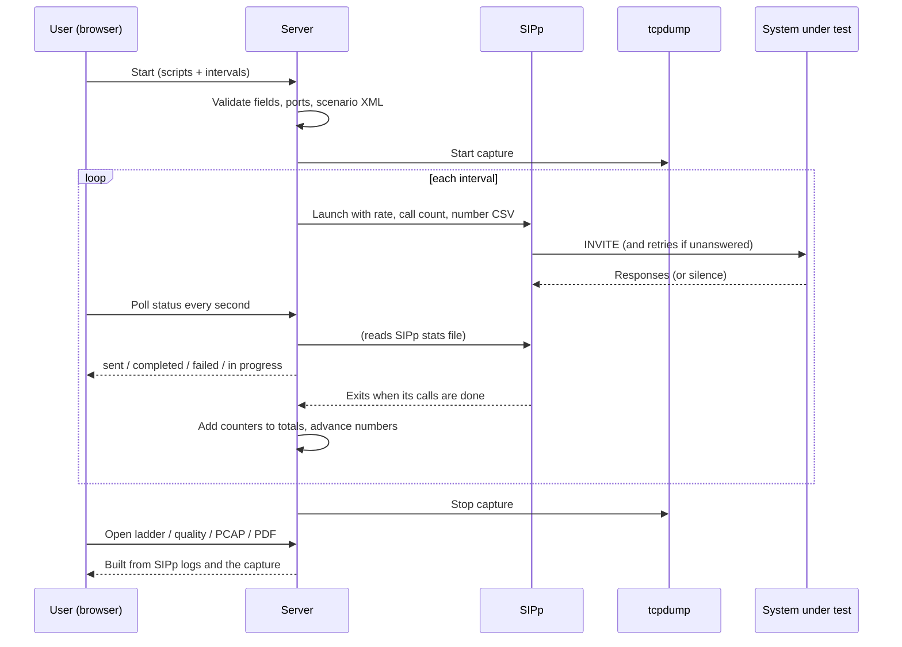
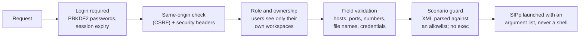

# Architecture and process flow

A high-level look at how A Better SIP Call Generator works. For day-to-day use see the
[User Guide](USER_GUIDE.md); for setup see the [README](../README.md).

## The idea in one paragraph

You describe what calls should look like (who calls whom, how fast, for how long, with
which media and security options). The app turns that into a SIPp scenario and a
schedule, starts SIPp for you, records the traffic, and turns SIPp's output into
counters, a ladder diagram, call-quality numbers, a PCAP and a PDF report. SIPp does the
SIP; this project is the control panel around it.

## Components

## What happens when you run a test

## Timeline of one call test (sequence)

## Key behaviors worth knowing

- **The schedule decides how many calls run.** Calls per interval = CPS x duration
  (rounded to the nearest whole call, minimum 1), split by each script's percentage. The
  number plan only chooses *which numbers* those calls use; it never changes how many.
- **Numbering continues.** A pause or a later interval picks up the number plan where the
  previous interval left off. (SIP Call-IDs are per SIPp process and restart each
  interval; the dialed numbers do not.)
- **Unanswered calls are not new calls.** SIPp retransmits an unanswered INVITE several
  times. The ladder shows those retries inside one call, and the counters report them
  separately as retransmits.
- **Counters are SIPp's own.** A call still in flight is "in progress", never "failed".
- **Each script uses its own files.** Scenario XML, number CSV and stats file names include
  the workspace and script, so scripts running at the same time cannot interfere.
- **Cleanup is automatic.** SIPp and tcpdump are tied to the server process. If the server
  stops or crashes, they stop too, and a startup check removes anything left behind.

## Security layers

Details and deployment advice are in [SECURITY.md](../SECURITY.md).

## Where things live

| Path | What it holds |
|---|---|
| `main.py` | App setup, middleware, startup and shutdown |
| `routes/` | API endpoints |
| `workspaces/` | Starting and stopping SIPp, intervals, capture, ladder data, RTP sender |
| `engines/` | Scenario guard, login, STIR/SHAKEN, PCAP reading, MOS, AI client, number plans |
| `models.py` | Request models and all input validation rules |
| `storage/` | JSON-file storage code (the data files themselves are git-ignored) |
| `static/` | The web UI |
| `scenarios/`, `audio/` | Sample scenarios and reference audio |
| `run/` | Temporary files from running tests (private, git-ignored) |
